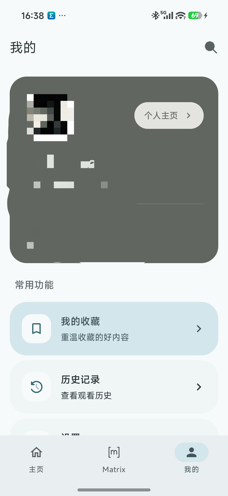
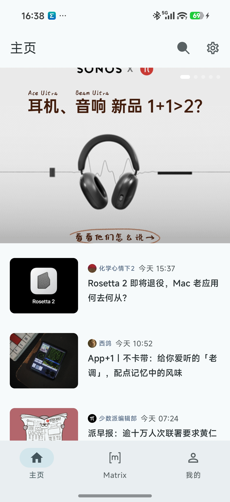
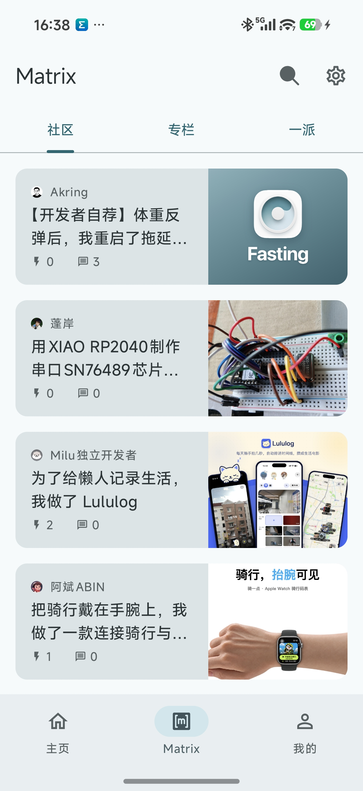
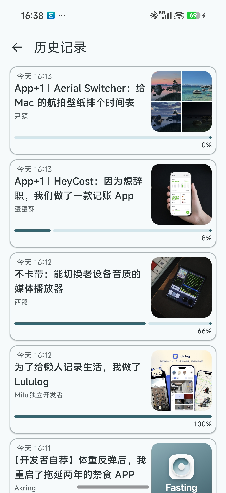
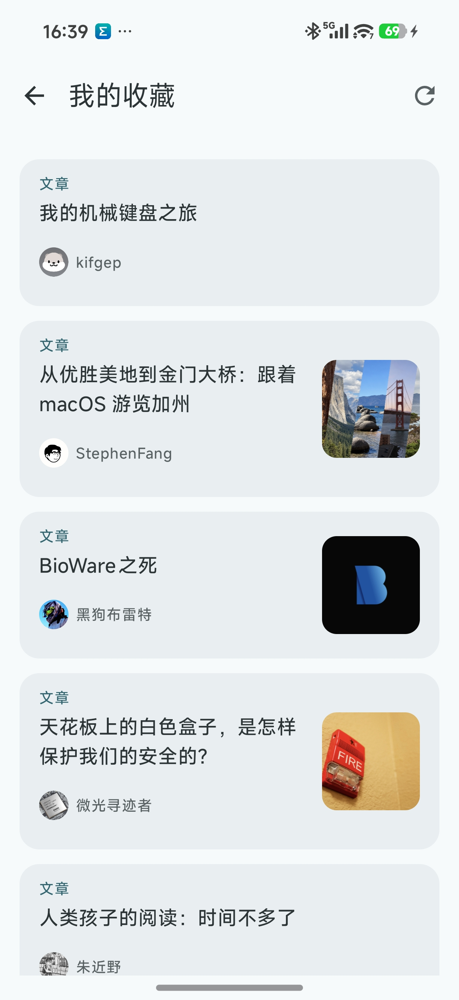
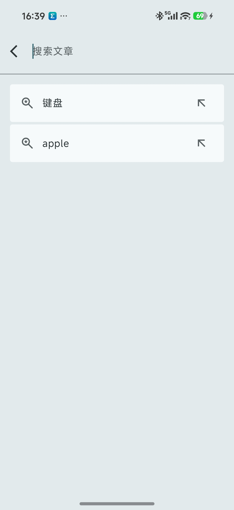
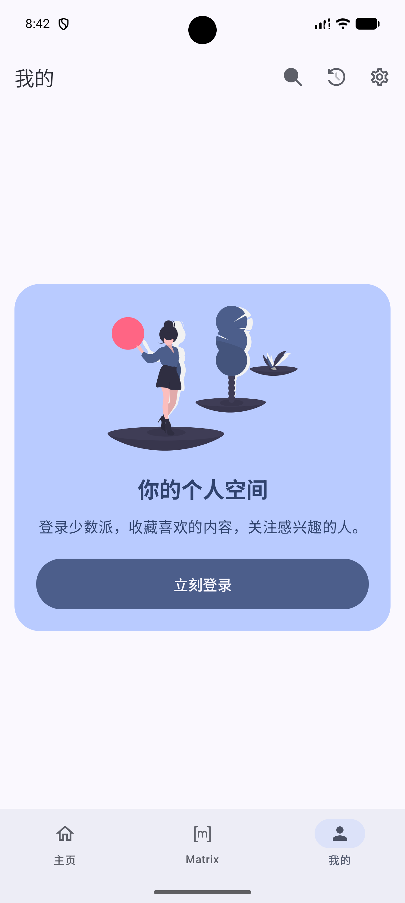
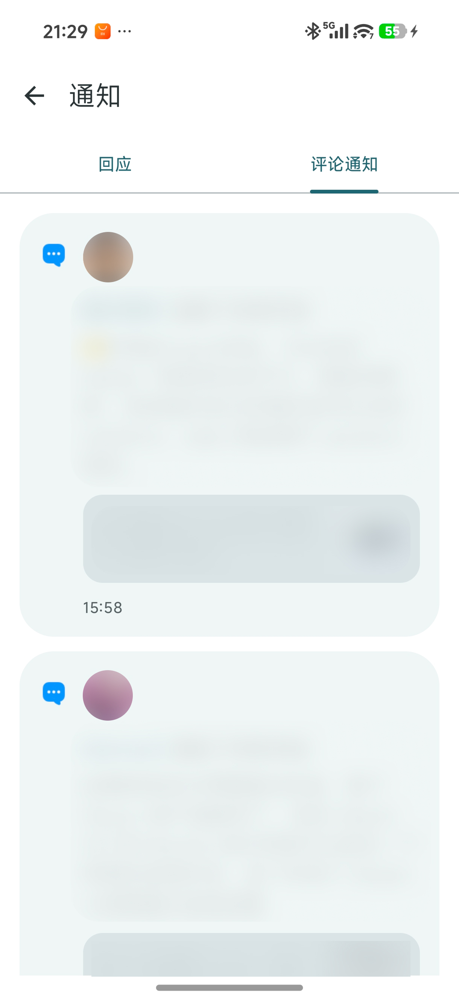
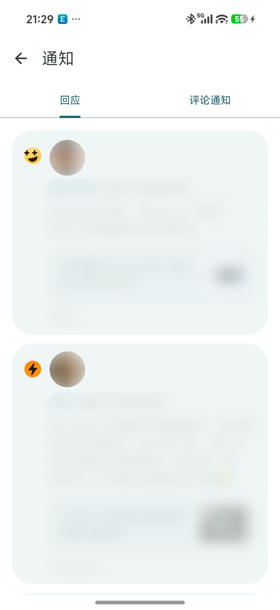

# SsPaiYou

第三方的少数派Android App，适配Material You。慢慢完善中。

## 前言

[少数派](https://sspai.com/)是一个我很喜欢的论坛，但是它的app是跨平台的架构，我在
iOS上感觉没有啥，但是后面换到Android客户端感觉有点小脱节，于是自己按照他们的Web API
写了一个第三方App，主要为自用，无其他想法。这个项目我很早就想写了，但是一直拖延，
现在AI出现了加上我又失去了工作才又重新捡起来写了。

我个人建议如果是少数派会员或者想要稳定体验还是选择[官方App](https://sspai.com/page/client)。

## 实现的功能

- 普通浏览体验；
- 登录功能（发布评论、点赞和收藏）；
- 本地历史记录。

## 不会实现的功能

- 任何与少数派会员相关的。

## 自己构建

1. 克隆此项目源码；
2. 克隆由大肥鱼写的[expressive-settings](https://github.com/shizheng233/expressive-settings)；
3. 修改`settings.gradle.kts`中的：

```diff
maven {
-    url = uri("D:\\AndroidProject\\expressive-settings\\build\\repo")
+    url = uri("你的expressive-settings\repo地址")
}
```
为什么会这样：因为我懒。

4. 可以尝试运行，然后一点一点修复遇见出现的编译问题，直至最后生成产物。

## 截屏

| 1                       | 2                       | 3                       |
|-------------------------|-------------------------|-------------------------|
|  |  |  |
|  |  |  |
|  |  |  |

## Cookie / Token 本地加密

`LocalTokenManager` 使用 Android Keystore 中不可导出的 AES-256 密钥，以
`AES/GCM/NoPadding` 加密 JWT 和 `cookieSaver()` 保存的其他 Cookie。 每次加密由系统生成新的 96 位
IV，使用 128 位认证标签，并将 Cookie 名称绑定为 AAD，防止密文被篡改或移到另一个 Cookie 名下。
`SharedPreferences` 只保存
`v1:` 前缀及 Base64 编码的 IV、密文和认证标签；用户名 slug 属于普通账号元数据。

对于本项目（最低 Android 10、需要自动登录）的本地凭据，直接使用 Android Keystore 是合适的方案。它负责保管密钥，Cookie
密文仍保存在应用私有目录。 不强制 StrongBox 或每次使用密钥时进行生物认证，以兼容设备并支持自动登录。
AndroidX Security Crypto 的 `EncryptedSharedPreferences` / `MasterKey` 已弃用， 官方建议使用平台 API
和 Android Keystore，因此这里不引入该依赖。

- 第一次读取或保存 Cookie 时，将旧 `TOKEN_MANAGER` 中所有明文 Cookie 一次性加密，
  与版本标记一起提交；迁移后的读取不再接受明文回退。
- 密文损坏、密钥丢失或失效时，丢弃无法解密的 Cookie；JWT 失效时同时清除 slug，
  返回未登录状态。新登录可重新创建密钥，加密失败不会降级保存明文。
- Android 10 备份、Android 12+ 云备份和设备迁移均排除 `TOKEN_MANAGER.xml`
  以及 WebView 数据目录，避免迁移无法解密的凭据或复制 WebView 会话。
- HTTP 日志中的 `Authorization`、`Cookie`、`Set-Cookie` 头均脱敏。
- `saveToken()` 已在 IO 线程执行；同步 Cookie 接口的调用方应在 IO 线程执行读写。

此处保护的是 `LocalTokenManager` 的落盘凭据；登录 WebView 自身的 Cookie 存储由 Android WebView
管理。卸载、清除应用数据或换机后需要重新登录。

参考：[Android Keystore](https://developer.android.com/privacy-and-security/keystore)、
[Security Crypto 弃用说明](https://developer.android.com/jetpack/androidx/releases/security#1.1.0-alpha07)。

## MIT License

```
Copyright (c) 2024 ShihCheeng Ch'en

Permission is hereby granted, free of charge, to any person obtaining a copy
of this software and associated documentation files (the "Software"), to deal
in the Software without restriction, including without limitation the rights
to use, copy, modify, merge, publish, distribute, sublicense, and/or sell
copies of the Software, and to permit persons to whom the Software is
furnished to do so, subject to the following conditions:

The above copyright notice and this permission notice shall be included in all
copies or substantial portions of the Software.

THE SOFTWARE IS PROVIDED "AS IS", WITHOUT WARRANTY OF ANY KIND, EXPRESS OR
IMPLIED, INCLUDING BUT NOT LIMITED TO THE WARRANTIES OF MERCHANTABILITY,
FITNESS FOR A PARTICULAR PURPOSE AND NONINFRINGEMENT. IN NO EVENT SHALL THE
AUTHORS OR COPYRIGHT HOLDERS BE LIABLE FOR ANY CLAIM, DAMAGES OR OTHER
LIABILITY, WHETHER IN AN ACTION OF CONTRACT, TORT OR OTHERWISE, ARISING FROM,
OUT OF OR IN CONNECTION WITH THE SOFTWARE OR THE USE OR OTHER DEALINGS IN THE
SOFTWARE.
 ```

